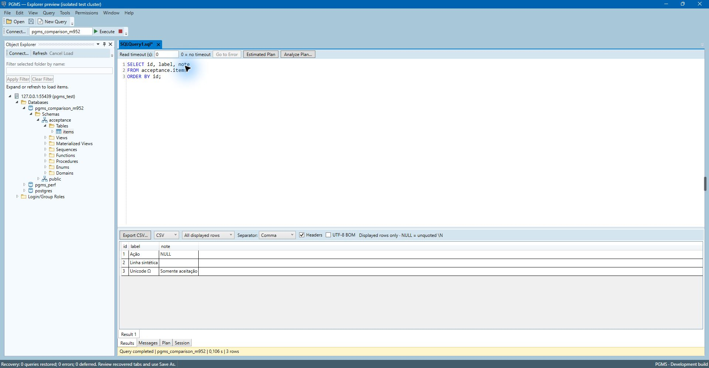

# PGMS — Postgres Management Studio

English | [Português (Brasil)](README.pt-BR.md)

A Windows desktop application for querying and administering PostgreSQL, built with C#, WPF, .NET 10 and Npgsql. Its interface takes inspiration from SQL Server Management Studio (SSMS), with PostgreSQL semantics and its own implementation.

**Pre-release: v0.1.0-alpha.1 (Windows x64).** [Download and installation](https://github.com/leoars/PostgresManagementStudio/releases/tag/v0.1.0-alpha.1) · [Release notes](docs/en/release-notes.md). Portable ZIP includes .NET/WPF; the optional installer is a PowerShell 7 script. Build label M1008 is an internal identifier. See the [validation guide](docs/en/validation.md) for accepted scope and known limits; full SSMS parity is not claimed.



Historical M957 preview captured during M959 using the isolated test cluster and synthetic data. This illustrates the interface, not the current release package. [Image provenance](docs/assets/README.md).

## Features

- SQL editor: highlighting, find/replace, multiple tabs, save/load and encrypted draft recovery.
- Independent PostgreSQL sessions, execute/cancel, Results/Messages, bounded result grids, copy and CSV/JSON export.
- Object Explorer, inspection, estimated/analyzed query plans and session configuration.
- Reviewed SQL administration for supported databases, schemas, tables, columns, identity, indexes, constraints, sequences, roles and privileges.
- Session/blocker monitoring, with distinct query cancellation and session termination.
- Logical backup/restore through external PostgreSQL tools: custom, tar, SQL and directory formats, plus reviewed global operations.

## Get started

For development: Windows x64, PowerShell 7 and the .NET SDK selected by [global.json](global.json) (`10.0.400`, latest installed patch in that feature band). PostgreSQL 17/18 and matching-major tools are needed for database tests and backup/restore.

```powershell
git clone https://github.com/leoars/PostgresManagementStudio.git
cd PostgresManagementStudio
./scripts/Build.ps1
dotnet run --project src/PGMS.Desktop
```

The self-contained portable package includes .NET/WPF, but no PostgreSQL server or tools. Local candidate ZIPs and acceptance artifacts are absent from a fresh clone. See [setup and packaging](docs/en/getting-started.md).

## Documentation

| Topic | English | Português (Brasil) |
| --- | --- | --- |
| Setup and packaging | [Guide](docs/en/getting-started.md) | [Guia](docs/pt-BR/getting-started.md) |
| Queries, administration, backup | [User guide](docs/en/user-guide.md) | [Guia de uso](docs/pt-BR/user-guide.md) |
| Build, tests, contributions | [Development](docs/en/development.md) | [Desenvolvimento](docs/pt-BR/development.md) |
| Structure | [Architecture](docs/en/architecture.md) | [Arquitetura](docs/pt-BR/architecture.md) |
| Evidence and limits | [Validation](docs/en/validation.md) | [Validação](docs/pt-BR/validation.md) |
| Attribution | [Licensing](docs/en/licensing.md) | [Licenças](docs/pt-BR/licensing.md) |

[Documentation index](docs/README.md). Public guides are maintained in both languages; the original internal development history is not included in this curated source repository. Bilingual documentation does not localize the application UI.

## Contribute and report problems

See [CONTRIBUTING.md](CONTRIBUTING.md). English and Brazilian Portuguese are welcome. Use synthetic data and remove credentials and personal information from reports. For vulnerabilities, follow [SECURITY.md](SECURITY.md).

## License

PGMS's original code and documentation use [MIT](LICENSE). Third-party components and the PostgreSQL elephant retain their own licenses and trademark terms; see [third-party notices](THIRD-PARTY-NOTICES.md). PGMS is independent, without endorsement by Microsoft or the PostgreSQL project. SSMS is a reference, not a distributed dependency.
