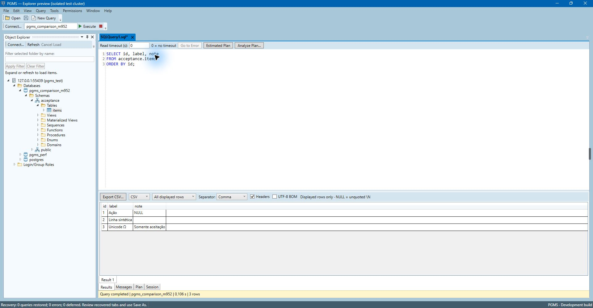
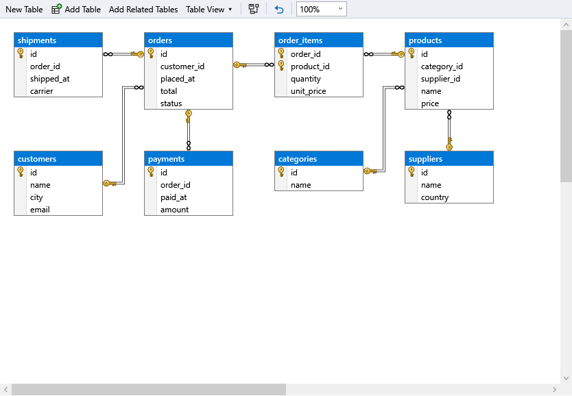
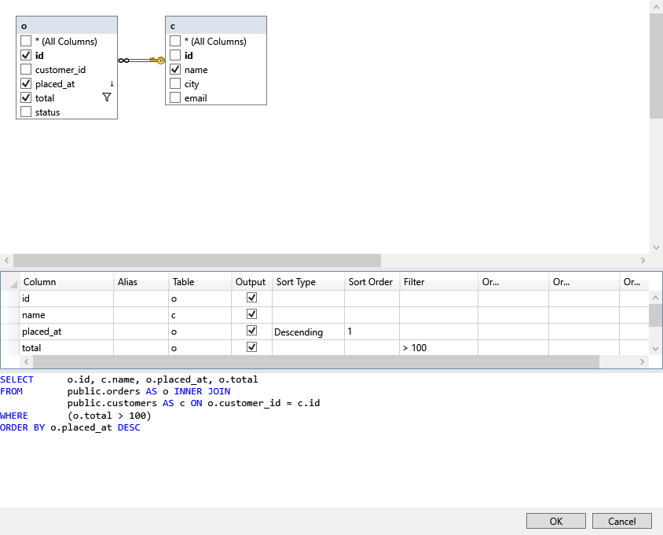
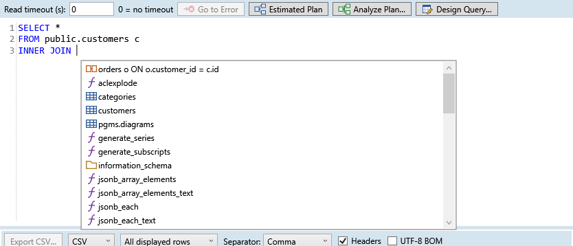

# PGMS — Postgres Management Studio

English | [Português (Brasil)](README.pt-BR.md)

[](https://github.com/leoars/PostgresManagementStudio/actions/workflows/build.yml) [](https://github.com/leoars/PostgresManagementStudio/releases) [](LICENSE)

**The SQL Server Management Studio experience, for PostgreSQL.** A native Windows client with **database diagrams**, a **visual query designer** and **context-aware IntelliSense**, plus Object Explorer, F5 to run, execution plans, session monitoring and backup/restore, built for people who already think in SSMS.

**[Download v0.1.0-beta.1 for Windows x64](https://github.com/leoars/PostgresManagementStudio/releases/tag/v0.1.0-beta.1)** · Graphical installer (EN/pt-BR) or portable ZIP, .NET runtime included · Works with PostgreSQL 16–18 · Interface in 8 languages



> First beta, still a pre-release: the features are complete for this version and it is meant for real work, but it can have bugs. Administration and backup run through reviewable SQL and the official PostgreSQL tools. Full SSMS parity is not claimed. See [known limits](docs/en/validation.md), the [release notes](docs/en/release-notes.md) and [how to report a problem](#contribute-and-report-problems).

**Contents:** [Highlights](#highlights) · [New in beta.1](#new-in-beta1) · [Why PGMS](#why-pgms) · [Features](#features) · [Get started](#get-started) · [Languages](#languages) · [Documentation](#documentation) · [Contribute and report problems](#contribute-and-report-problems) · [License](#license)

## Highlights

### Write SQL with AI

Describe what you need and **Query ▸ Generate SQL with AI…** (`Ctrl+I`) writes the SQL for you to review before it reaches the editor. Keep the conversation going with follow-up requests, or select SQL and use **Explain**, **Fix** or **Optimize SQL with AI** from the Query menu. It works with Anthropic, OpenAI or a local Ollama, with your own key. What goes to the provider: your request, the database structure (names, types, keys, comments) and, for **Fix**, the SQLSTATE and main message of the last error. Table data is never read or sent, nothing is sent until you press **Generate**, and the SQL is never executed for you. On large databases the provider first picks the relevant tables by name, within a context limit you set. **View Sent Context…** shows exactly what was sent.

### Configure Server TLS

A guided setup that creates or imports a certificate, installs it in the server's data directory, turns on TLS with `ALTER SYSTEM`, checks a TLS session with that certificate and restores the previous settings if anything fails. Saved profiles for that server then verify the certificate. It requires a superuser connection to a PostgreSQL server running on Windows.

### Database diagrams



See your schema the way you see it in SSMS. Add tables and their related tables, drag one column onto another to create a foreign key, change columns and primary keys inside the diagram, and let **Arrange Tables** lay everything out. Every change to the database is shown as a SQL script for review first. Diagrams are saved on the server, in a small `pgms` schema that PGMS asks permission to create.

Diagrams also show each table's **indexes** (GIN, GiST, BRIN and operator classes such as `gin_trgm_ops`, in a section closed by default) and warn about foreign keys that no index serves. Tables, columns and relationships can carry **descriptions**, stored as PostgreSQL `COMMENT ON`. **Export for AI…** writes the diagram as Markdown (columns, keys, relationships, indexes and descriptions) to give an AI agent before it writes SQL; an optional `pgms.diagram_markdown(name)` function returns the same text inside the database. See [Using diagrams with AI agents](docs/en/user-guide.md#using-diagrams-with-ai-agents).

### Visual query designer



Build queries by clicking instead of typing. **Query ▸ Design Query in Editor** (`Ctrl+Shift+Q`) opens the statement under the cursor in synchronized Diagram, Criteria and SQL panes: tick columns, set filters and sort order, and joins come from your foreign keys. Change the type to Update, Delete, Insert or Make Table. It only writes SQL into your editor and never runs it. `UNION` and `WITH` open in the SQL pane only.

### IntelliSense that knows where you are



Press `Ctrl+Space` and get what fits that position. After `FROM`: tables, views and table functions, found by name across all your schemas. After `JOIN`: the whole join from your foreign keys, such as `orders o ON o.customer_id = c.id`. After an alias: its columns. Typing ignores accents, so `usuar` finds `Usuários`. Parameter Info (`Ctrl+Shift+Space`) shows the arguments of a function while you type, and Quick Info describes the name under the mouse. CTE columns are not known yet.

### Also in PGMS

- **Execution plan advice.** Graphical plans flag operators that discard many rows and suggest a missing index as a commented `CREATE INDEX` script, checked against the catalog and never run for you.
- **Schema Compare.** Compare two databases and get a change script in a query tab connected to the target, for you to review and run.
- **Query History.** Every query you run, grouped and searchable, stored only on your computer and encrypted for your Windows user.
- **PostGIS.** `geometry` and `geography` values appear as EWKT text in the grid, Results to Text, copy and export, and Table Designer accepts types such as `geometry(Point,4326)`.

## New in beta.1

- **Interface in 8 languages:** English, Português (Brasil), Español, Deutsch, Italiano, Français, 한국어 and 日本語 (see [Languages](#languages)).
- **The 13 SSMS color themes** (Cool Breeze by default), plus Use system setting.
- **Execution plans:** Show Execution Plan JSON or as Text, and **Compare Showplan** with another plan file or the previous plan of the same tab, with the operators that differ highlighted in the drawing.
- **PostGIS** values shown as EWKT (above).
- **Update notice:** a few seconds after start, release packages ask the GitHub API whether a newer release exists (GitHub sees your IP address, as with any web request) and show **Update available** in the title bar. Nothing is downloaded or installed. You can turn it off in Tools ▸ Options ▸ Environment ▸ Product Updates.
- **More of the SSMS Options:** AutoRecover, Documents, Tabs, Windows, the seven SQL Formatter pages, Table Options, Object Explorer General and Commands, and Live Query Statistics. Each option works or is shown disabled with the reason.
- Editor and windows: Paste Special (Format SQL, Paste with AI), Switch Completion Mode, File ▸ New ▸ File, Code Snippets Manager, Navigate Backward/Forward, Pin Tab (kept on recovered and reopened tabs), All Windows, several result sets in tabs or stacked.
- PGMS message boxes with buttons in the PGMS language; keyboard and screen reader fixes; windows fit the screen at 150–175% scaling; faster result grids.

**Defaults that changed to match SSMS:** new tabs open first (after pinned tabs), unsaved queries are backed up every 5 minutes, system schemas and template databases are listed in Object Explorer (in the System Schemas and System Databases folders), Table Designer saves stop after 3600 seconds, Live Query Statistics reads every 250 ms and Format SQL writes `VARCHAR (20)`. Settings you changed yourself are kept; each one can be changed back in Tools ▸ Options.

See the [release notes](docs/en/release-notes.md) for details and limits.

## Why PGMS

- **Feels like SSMS.** Object Explorer, query tabs with their own sessions, Results/Messages, F5 and the shortcuts you already use.
- **Review before you apply.** Administrative changes are shown as SQL first, so nothing touches the server without you reading it.
- **Know what's running.** Session and blocker monitor that distinguishes cancelling a query from terminating a session.
- **Native and fast.** C#/WPF on .NET 10, no browser and no JVM.
- **Your drafts survive.** Unsaved query tabs are checkpointed and recovered after a crash or forced close, encrypted per Windows user.

## Features

- SQL editor: highlighting, context-aware IntelliSense with Parameter Info and Quick Info, Format SQL, templates and snippets, bookmarks, find/replace and Find in Files, multiple tabs, save/load and encrypted draft recovery.
- Database diagrams, Table Designer, View Designer and Query Designer.
- Independent PostgreSQL sessions, execute/cancel, Results/Messages, result grids in pages of 100,000 rows (configurable), results to text or file, copy, Save Grid Results and CSV/JSON export, Query History and Live Query Statistics.
- Object Explorer and Object Explorer Details, the Properties window, Script as, extensions and maintenance, graphical execution plans (estimated and actual), Schema Compare and session configuration.
- Reviewed SQL administration for supported databases, schemas, tables, columns, identity, indexes, constraints, sequences, roles and privileges.
- Session/blocker monitoring, with distinct query cancellation and session termination.
- Logical backup/restore through external PostgreSQL tools: custom, tar, SQL and directory formats, gzip/LZ4/Zstandard, parallel and partial restore, plus reviewed global operations.
- The SSMS themes (Cool Breeze, Light, Dark and the color themes), Fonts and Colors, keyboard shortcuts, window layouts and an interface in 8 languages.

## Get started

### Install

Download the installer or the ZIP from the [latest release](https://github.com/leoars/PostgresManagementStudio/releases), run it, then use **Connect** and **New Query**. Backup/restore needs the PostgreSQL client tools (`pg_dump`, `pg_restore`, `psql`) of the same major version as the server. Details: [setup guide](docs/en/getting-started.md).

#### Windows SmartScreen warning

PGMS releases are not code-signed yet, so Windows may show "Windows protected your PC" the first time you run the installer or `PGMS.exe`. Choose **More info** and then **Run anyway**. Before doing so, confirm the download matches the checksums published with the release:

```powershell
Get-FileHash .\PGMS-* -Algorithm SHA256
```

Compare the hashes with `SHA256SUMS.txt` in the release. Starting with v0.1.0-alpha.2 the assets are built by the [release workflow](.github/workflows/release.yml) on GitHub Actions and carry a build provenance attestation, so you can also confirm that the ZIP or installer came from that workflow and this repository (requires the [GitHub CLI](https://cli.github.com/)):

```powershell
gh attestation verify .\PGMS-0.1.0-beta.1-Setup-x64.exe --repo leoars/PostgresManagementStudio
```

v0.1.0-alpha.1 was built on the maintainer's machine and has checksums only. Code signing through the SignPath Foundation open source program is planned.

### Build from source

For development: Windows x64, PowerShell 7 and the .NET SDK selected by [global.json](global.json) (`10.0.400`, latest installed patch in that feature band). PostgreSQL 16–18 and matching-major tools are needed for database tests and backup/restore.

```powershell
git clone https://github.com/leoars/PostgresManagementStudio.git
cd PostgresManagementStudio
./scripts/Build.ps1
dotnet run --project src/PGMS.Desktop
```

The self-contained portable package includes .NET/WPF, but no PostgreSQL server or tools. Local candidate ZIPs and acceptance artifacts are absent from a fresh clone. See [setup and packaging](docs/en/getting-started.md).

## Languages

The interface is available in English, Português (Brasil), Español, Deutsch, Italiano, Français, 한국어 and 日本語. By default PGMS follows the Windows display language (English when Windows uses another one); choose another in **Tools ▸ Options ▸ Environment ▸ International Settings** and restart PGMS. As in SSMS, some things stay in English on purpose: Object Explorer folder names, command names in the Keyboard page, SQL keywords and anything that comes from the server or your data.

**The translations have not been reviewed by native speakers yet.** If a text is wrong, unclear or still in English, please [report a translation problem](https://github.com/leoars/PostgresManagementStudio/issues/new?template=translation.yml) with the language, the window and the text you saw. The guides are maintained in English and Brazilian Portuguese only.

## Documentation

| Topic | English | Português (Brasil) |
| --- | --- | --- |
| Setup and packaging | [Guide](docs/en/getting-started.md) | [Guia](docs/pt-BR/getting-started.md) |
| Queries, administration, backup | [User guide](docs/en/user-guide.md) | [Guia de uso](docs/pt-BR/user-guide.md) |
| Build, tests, contributions | [Development](docs/en/development.md) | [Desenvolvimento](docs/pt-BR/development.md) |
| Structure | [Architecture](docs/en/architecture.md) | [Arquitetura](docs/pt-BR/architecture.md) |
| Evidence and limits | [Validation](docs/en/validation.md) | [Validação](docs/pt-BR/validation.md) |
| Attribution | [Licensing](docs/en/licensing.md) | [Licenças](docs/pt-BR/licensing.md) |

[Documentation index](docs/README.md). Public guides are maintained in both languages; the original internal development history is not included in this curated source repository.

## Contribute and report problems

**If PGMS hits an error.** An unexpected error opens a window with the details; PGMS also writes them to a daily log in `%LOCALAPPDATA%\PGMS\logs` (kept 30 days, nothing sent over the network). Choose **Report Issue**, describe what you were doing and attach the log or the text from **Copy Details** after reading it: an error message can quote what the server sent. You can usually choose **Continue**; your open queries keep their text.

**Any other problem.** [Open a bug report](https://github.com/leoars/PostgresManagementStudio/issues/new?template=bug_report.yml): the form asks for the PGMS version (Help ▸ About), the Windows and PostgreSQL versions, how you installed PGMS, the steps, what you expected and what happened, and the log when there is one.

See [CONTRIBUTING.md](CONTRIBUTING.md) and the [code of conduct](CODE_OF_CONDUCT.md). English and Brazilian Portuguese are welcome. Issue templates guide bug reports and feature requests; usage questions go to [Discussions](https://github.com/leoars/PostgresManagementStudio/discussions). Use synthetic data and remove credentials and personal information from reports. For vulnerabilities, follow [SECURITY.md](SECURITY.md).

## License

PGMS is created and maintained by [Leonardo Santos](https://github.com/leoars). Its original code and documentation use [Apache-2.0](LICENSE): free for personal and business use, keeping the copyright and the credits in [NOTICE](NOTICE). Releases through 0.1.0-alpha.4 remain under MIT. Third-party components and the PostgreSQL elephant retain their own licenses and trademark terms; see [third-party notices](THIRD-PARTY-NOTICES.md). PGMS is independent, without endorsement by Microsoft or the PostgreSQL project. SSMS is a reference, not a distributed dependency.
