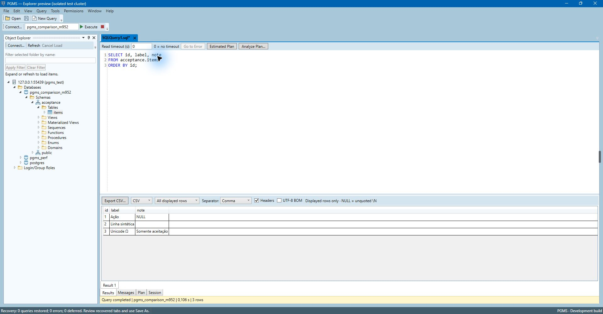
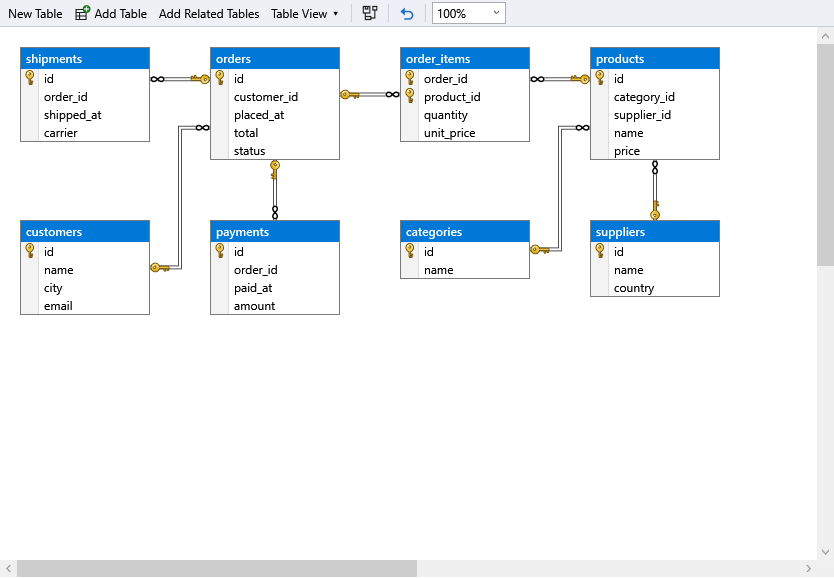
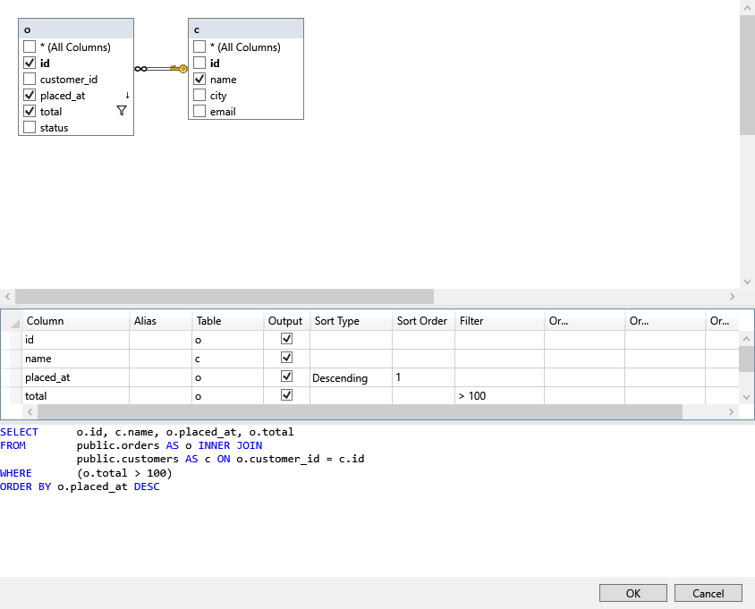
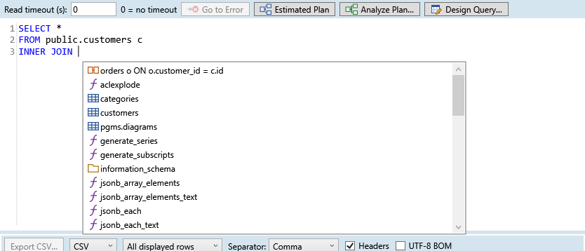

# PGMS — Postgres Management Studio

[English](README.md) | Português (Brasil)

[](https://github.com/leoars/PostgresManagementStudio/actions/workflows/build.yml) [](https://github.com/leoars/PostgresManagementStudio/releases) [](LICENSE)

**A experiência do SQL Server Management Studio, para PostgreSQL.** Cliente nativo Windows com **diagramas de banco**, **Query Designer visual** e **IntelliSense por contexto**, além de Object Explorer, F5 para executar, planos de execução, monitor de sessões e backup/restore, feito para quem já pensa em SSMS.

**[Baixar v0.1.0-alpha.7 para Windows x64](https://github.com/leoars/PostgresManagementStudio/releases/tag/v0.1.0-alpha.7)** · Instalador gráfico (EN/pt-BR) ou ZIP portátil, runtime .NET incluído · Funciona com PostgreSQL 16 a 18



> Pré-release inicial. Consultas, navegação e monitoramento são o núcleo desta alpha; administração e backup usam SQL revisável e as ferramentas oficiais do PostgreSQL. Não se declara paridade integral com SSMS. Veja os [limites conhecidos](docs/pt-BR/validation.md) e as [notas da versão](docs/pt-BR/release-notes.md).

**Conteúdo:** [Destaques](#destaques) · [Novidades da alpha.7](#novidades-da-alpha7) · [Por que o PGMS](#por-que-o-pgms) · [Funcionalidades](#funcionalidades) · [Começar](#começar) · [Documentação](#documentação) · [Contribuir e relatar problemas](#contribuir-e-relatar-problemas) · [Licença](#licença)

## Destaques

### Escrever SQL com IA

Descreva o que você precisa e **Query ▸ Generate SQL with AI…** (`Ctrl+I`) escreve o SQL para você revisar antes de ele ir para o editor. Continue a conversa com pedidos de seguimento, ou selecione um SQL e use **Explain**, **Fix** ou **Optimize SQL with AI** no menu Query. Funciona com Anthropic, OpenAI ou um Ollama local, com a sua própria chave. O que vai para o provedor: o seu pedido, a estrutura do banco (nomes, tipos, chaves, comentários) e, no **Fix**, o SQLSTATE e a mensagem principal do último erro. Dados das tabelas nunca são lidos nem enviados, nada é enviado antes de você clicar em **Generate**, e o SQL nunca é executado por conta própria. Em bancos grandes, o provedor primeiro escolhe as tabelas relevantes pelos nomes, dentro de um limite de contexto que você define. **View Sent Context…** mostra exatamente o que foi enviado.

### Configure Server TLS

Um assistente que cria ou importa um certificado, instala-o no diretório de dados do servidor, liga o TLS com `ALTER SYSTEM`, confere uma sessão TLS com esse certificado e restaura a configuração anterior se algo falhar. Os perfis salvos desse servidor passam a verificar o certificado. Exige conexão de superusuário a um servidor PostgreSQL rodando no Windows.

### Diagramas de banco de dados



Veja o seu schema como no SSMS. Adicione tabelas e as tabelas relacionadas, arraste uma coluna sobre outra para criar uma chave estrangeira, altere colunas e chaves primárias dentro do diagrama e deixe o **Arrange Tables** organizar tudo. Toda alteração no banco aparece antes como script SQL para revisão. Os diagramas ficam salvos no servidor, num pequeno schema `pgms` que o PGMS pede permissão para criar.

O diagrama também mostra os **índices** de cada tabela (GIN, GiST, BRIN e classes de operadores como `gin_trgm_ops`, numa seção recolhida por padrão) e avisa das chaves estrangeiras sem índice. Tabelas, colunas e relações podem ter **descrições**, gravadas como `COMMENT ON` do PostgreSQL. **Export for AI…** gera o diagrama em Markdown (colunas, chaves, relações, índices e descrições) para entregar a um agente de IA antes de ele escrever SQL; a função opcional `pgms.diagram_markdown(nome)` devolve o mesmo texto dentro do banco. Veja [Usando diagramas com agentes de IA](docs/pt-BR/user-guide.md#usando-diagramas-com-agentes-de-ia).

### Query Designer visual



Monte consultas clicando, em vez de digitar. **Query ▸ Design Query in Editor** (`Ctrl+Shift+Q`) abre a instrução sob o cursor nos painéis Diagram, Criteria e SQL, sempre sincronizados: marque colunas, defina filtros e ordenação, e as junções vêm das suas chaves estrangeiras. Mude o tipo para Update, Delete, Insert ou Make Table. Ele só escreve SQL no editor e nunca executa nada. `UNION` e `WITH` abrem apenas no painel SQL.

### IntelliSense que sabe onde você está



Aperte `Ctrl+Space` e receba o que cabe naquela posição. Depois de `FROM`: tabelas, views e funções de tabela, encontradas pelo nome em todos os seus schemas. Depois de `JOIN`: a junção inteira a partir das chaves estrangeiras, como `orders o ON o.customer_id = c.id`. Depois de um alias: as colunas dele. A busca ignora acentos, então `usuar` encontra `Usuários`. Parameter Info (`Ctrl+Shift+Space`) mostra os argumentos de uma função enquanto você digita, e Quick Info descreve o nome sob o mouse. Colunas de CTE ainda não são conhecidas.

### Também no PGMS

- **Dicas no plano de execução.** O plano gráfico marca operadores que descartam muitas linhas e sugere um índice faltante como script `CREATE INDEX` comentado, conferido no catálogo e nunca executado por conta própria.
- **Schema Compare.** Compare dois bancos e receba um script de mudanças numa aba de consulta conectada ao destino, para você revisar e executar.
- **Query History.** Cada consulta que você executa, agrupada e pesquisável, guardada só no seu computador e criptografada para o seu usuário do Windows.

## Novidades da alpha.7

- **Conversa com a IA** e **Explain / Fix / Optimize SQL with AI**.
- **Tema escuro**, Editor Appearance, Fonts and Colors e Presenter Mode.
- **Erros inesperados ficam registrados** em `%LOCALAPPDATA%\PGMS\logs` e aparecem numa janela com **Report Issue**, em vez de fechar o PGMS em silêncio.
- Editor: Format SQL, Parameter Info e Quick Info, marcadores, outlining, modelos e trechos, Find in Files, verificação ortográfica de comentários e cadeias e os comandos de Edit ▸ Advanced do SSMS.
- Schema Compare, Live Query Statistics (progresso, esperas e bloqueios), Object Explorer Details (`F7`), a janela Properties (`F4`), Error List e Output.
- Object Explorer: extensões, manutenção (Vacuum, Analyze, Refresh Materialized View), menus de chaves, constraints e triggers, tipos compostos, servidores estrangeiros e replicação lógica.
- Backup com LZ4/Zstandard, restore paralelo e restauração só dos itens escolhidos; certificados de cliente no Connect.
- Layouts de janela, Split Tab, Full Screen, Restore Closed Tab, menu na barra de título com Search (`Ctrl+Q`), Keyboard e Query Shortcuts, Import and Export Settings e External Tools.

Veja as [notas da versão](docs/pt-BR/release-notes.md) para detalhes e limites.

## Por que o PGMS

- **Parece o SSMS.** Object Explorer, abas de consulta com sessão própria, Results/Messages, F5 e os atalhos que você já usa.
- **Revise antes de aplicar.** Mudanças administrativas aparecem primeiro como SQL; nada chega ao servidor sem você ler.
- **Saiba o que está rodando.** Monitor de sessões e bloqueios que distingue cancelar a consulta de encerrar a sessão.
- **Nativo e rápido.** C#/WPF em .NET 10, sem navegador e sem JVM.
- **Seus rascunhos sobrevivem.** Abas não salvas têm checkpoint periódico e são recuperadas após falha ou fechamento forçado, criptografadas por usuário do Windows.

## Funcionalidades

- Editor SQL: destaque, IntelliSense por contexto com Parameter Info e Quick Info, Format SQL, modelos e trechos, marcadores, busca/substituição e Find in Files, múltiplas abas, abrir/salvar e recuperação criptografada de rascunhos.
- Diagramas de banco, Table Designer, View Designer e Query Designer.
- Sessões PostgreSQL independentes, executar/cancelar, Results/Messages, grade em páginas de 100.000 linhas (configurável), resultados em texto ou arquivo, cópia, Save Grid Results e exportação CSV/JSON, Query History e Live Query Statistics.
- Object Explorer e Object Explorer Details, janela Properties, Script as, extensões e manutenção, planos de execução gráficos (estimados e reais), Schema Compare e configuração da sessão.
- Administração com SQL revisável nos casos suportados de bancos, schemas, tabelas, colunas, identity, índices, constraints, sequences, roles e privilégios.
- Monitor de sessões/bloqueadores, com cancelamento de consulta e encerramento de sessão distintos.
- Backup/restore lógico por ferramentas externas PostgreSQL: custom, tar, SQL e diretório, gzip/LZ4/Zstandard, restore paralelo e parcial, além de operações globais revisadas.
- Tema claro, escuro ou do sistema, Fonts and Colors, atalhos de teclado e layouts de janela.

## Começar

### Instalar

Baixe o instalador ou o ZIP na [release mais recente](https://github.com/leoars/PostgresManagementStudio/releases), execute e use **Connect** e **New Query**. Backup/restore exige as ferramentas cliente do PostgreSQL (`pg_dump`, `pg_restore`, `psql`) da mesma versão principal do servidor. Detalhes: [guia de preparação](docs/pt-BR/getting-started.md).

#### Aviso do SmartScreen do Windows

As releases do PGMS ainda não são assinadas digitalmente, então o Windows pode mostrar "O Windows protegeu o computador" na primeira execução do instalador ou do `PGMS.exe`. Clique em **Mais informações** e depois em **Executar assim mesmo**. Antes disso, confirme que o download corresponde aos checksums publicados com a release:

```powershell
Get-FileHash .\PGMS-* -Algorithm SHA256
```

Compare os hashes com o `SHA256SUMS.txt` da release. A partir da v0.1.0-alpha.2 os assets são compilados pelo [workflow de release](.github/workflows/release.yml) no GitHub Actions e trazem atestado de proveniência de build, então você também pode confirmar que o ZIP ou o instalador saiu desse workflow e deste repositório (exige o [GitHub CLI](https://cli.github.com/)):

```powershell
gh attestation verify .\PGMS-0.1.0-alpha.7-Setup-x64.exe --repo leoars/PostgresManagementStudio
```

A v0.1.0-alpha.1 foi compilada na máquina do mantenedor e tem apenas checksums. A assinatura de código pelo programa open source da SignPath Foundation está planejada.

### Compilar a partir do código

Para desenvolvimento: Windows x64, PowerShell 7 e SDK .NET selecionado por [global.json](global.json) (`10.0.400`, com o patch mais recente instalado nessa faixa). PostgreSQL 16–18 e ferramentas da mesma versão principal são necessários para testes com banco e backup/restore.

```powershell
git clone https://github.com/leoars/PostgresManagementStudio.git
cd PostgresManagementStudio
./scripts/Build.ps1
dotnet run --project src/PGMS.Desktop
```

O pacote portátil self-contained inclui .NET/WPF, sem servidor ou ferramentas PostgreSQL. ZIPs candidatos e artefatos locais de aceitação não vêm em um clone novo. Veja [preparação e empacotamento](docs/pt-BR/getting-started.md).

## Documentação

| Assunto | English | Português (Brasil) |
| --- | --- | --- |
| Preparação e empacotamento | [Guide](docs/en/getting-started.md) | [Guia](docs/pt-BR/getting-started.md) |
| Consultas, administração, backup | [User guide](docs/en/user-guide.md) | [Guia de uso](docs/pt-BR/user-guide.md) |
| Build, testes, contribuições | [Development](docs/en/development.md) | [Desenvolvimento](docs/pt-BR/development.md) |
| Estrutura | [Architecture](docs/en/architecture.md) | [Arquitetura](docs/pt-BR/architecture.md) |
| Provas e limites | [Validation](docs/en/validation.md) | [Validação](docs/pt-BR/validation.md) |
| Atribuição | [Licensing](docs/en/licensing.md) | [Licenças](docs/pt-BR/licensing.md) |

[Índice da documentação](docs/README.md). Guias públicos são mantidos nos dois idiomas; o histórico interno original não está incluído nesta cópia pública selecionada. Documentação bilíngue não localiza a interface do aplicativo.

## Contribuir e relatar problemas

**Se o PGMS der erro.** Um erro inesperado abre uma janela com os detalhes; o PGMS também os grava num log diário em `%LOCALAPPDATA%\PGMS\logs` (guardado por 30 dias, nada é enviado pela rede). Escolha **Report Issue**, conte o que você estava fazendo e anexe o log ou o texto de **Copy Details** depois de lê-lo: uma mensagem de erro pode citar o que o servidor enviou. Em geral dá para escolher **Continue**; as consultas abertas mantêm o texto.

Veja [CONTRIBUTING.pt-BR.md](CONTRIBUTING.pt-BR.md) e o [código de conduta](CODE_OF_CONDUCT.pt-BR.md). Os modelos de issue orientam relatos de defeito e pedidos de funcionalidade; dúvidas de uso vão para [Discussions](https://github.com/leoars/PostgresManagementStudio/discussions). Inglês e português do Brasil são bem-vindos. Use dados sintéticos e remova credenciais e informações pessoais dos relatos. Para vulnerabilidades, siga [SECURITY.pt-BR.md](SECURITY.pt-BR.md).

## Licença

O PGMS é criado e mantido por [Leonardo Santos](https://github.com/leoars). Código e documentação próprios usam a [Apache-2.0](LICENSE): uso livre pessoal e em empresas, mantendo o copyright e os créditos do [NOTICE](NOTICE). As versões até 0.1.0-alpha.4 continuam sob MIT. Componentes de terceiros e o elefante PostgreSQL mantêm suas licenças e condições de marca; veja os [avisos de terceiros](THIRD-PARTY-NOTICES.md). O PGMS é independente, sem endosso da Microsoft ou do projeto PostgreSQL. SSMS é referência, sem dependência distribuída.
