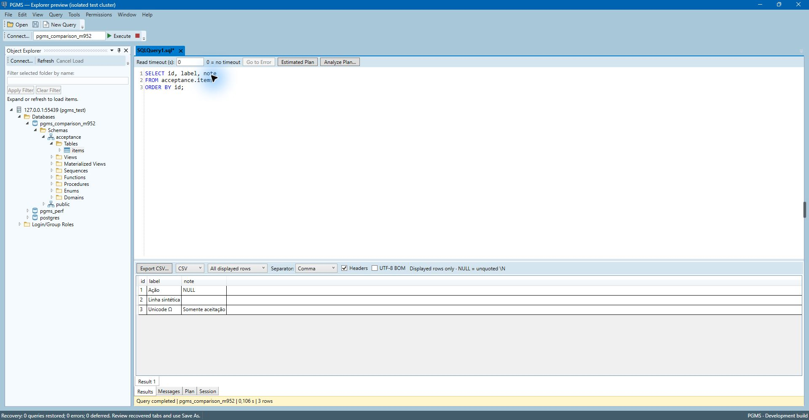

# PGMS — Postgres Management Studio

[English](README.md) | Português (Brasil)

[](https://github.com/leoars/PostgresManagementStudio/actions/workflows/build.yml) [](https://github.com/leoars/PostgresManagementStudio/releases) [](LICENSE)

**A experiência do SQL Server Management Studio, para PostgreSQL.** Cliente nativo Windows com Object Explorer, F5 para executar, planos de execução, monitor de sessões e backup/restore, feito para quem já pensa em SSMS.

**[Baixar v0.1.0-alpha.4 para Windows x64](https://github.com/leoars/PostgresManagementStudio/releases/tag/v0.1.0-alpha.4)** · Instalador gráfico (EN/pt-BR) ou ZIP portátil, runtime .NET incluído · Funciona com PostgreSQL 16 a 18



> Pré-release inicial. Consultas, navegação e monitoramento são o núcleo desta alpha; administração e backup usam SQL revisável e as ferramentas oficiais do PostgreSQL. Não se declara paridade integral com SSMS. Veja os [limites conhecidos](docs/pt-BR/validation.md) e as [notas da versão](docs/pt-BR/release-notes.md).

## Por que o PGMS

- **Parece o SSMS.** Object Explorer, abas de consulta com sessão própria, Results/Messages, F5 e os atalhos que você já usa.
- **Revise antes de aplicar.** Mudanças administrativas aparecem primeiro como SQL; nada chega ao servidor sem você ler.
- **Saiba o que está rodando.** Monitor de sessões e bloqueios que distingue cancelar a consulta de encerrar a sessão.
- **Nativo e rápido.** C#/WPF em .NET 10, sem navegador e sem JVM.
- **Seus rascunhos sobrevivem.** Abas não salvas têm checkpoint periódico e são recuperadas após falha ou fechamento forçado, criptografadas por usuário do Windows.

## Funcionalidades

- Editor SQL: destaque, busca/substituição, múltiplas abas, abrir/salvar e recuperação criptografada de rascunhos.
- Sessões PostgreSQL independentes, executar/cancelar, Results/Messages, grade com limites, cópia e exportação CSV/JSON.
- Object Explorer, inspeção, planos estimados/analisados e configuração da sessão.
- Administração com SQL revisável nos casos suportados de bancos, schemas, tabelas, colunas, identity, índices, constraints, sequences, roles e privilégios.
- Monitor de sessões/bloqueadores, com cancelamento de consulta e encerramento de sessão distintos.
- Backup/restore lógico por ferramentas externas PostgreSQL: custom, tar, SQL e diretório, além de operações globais revisadas.

## Começar

### Instalar

Baixe o instalador ou o ZIP na [release mais recente](https://github.com/leoars/PostgresManagementStudio/releases), execute e use **Connect** e **New Query**. Backup/restore exige as ferramentas cliente do PostgreSQL (`pg_dump`, `pg_restore`, `psql`) da mesma versão principal do servidor. Detalhes: [guia de preparação](docs/pt-BR/getting-started.md).

#### Aviso do SmartScreen do Windows

As releases do PGMS ainda não são assinadas digitalmente, então o Windows pode mostrar "O Windows protegeu o computador" na primeira execução do instalador ou do `PGMS.exe`. Clique em **Mais informações** e depois em **Executar assim mesmo**. Antes disso, confirme que o download corresponde aos checksums publicados com a release:

```powershell
Get-FileHash .\PGMS-* -Algorithm SHA256
```

Compare os hashes com o `SHA256SUMS.txt` da release. A partir da v0.1.0-alpha.2 os assets são compilados pelo [workflow de release](.github/workflows/release.yml) no GitHub Actions e trazem atestado de proveniência de build, então você também pode confirmar que o ZIP ou o instalador saiu desse workflow e deste repositório (exige o [GitHub CLI](https://cli.github.com/)):

```powershell
gh attestation verify .\PGMS-0.1.0-alpha.4-Setup-x64.exe --repo leoars/PostgresManagementStudio
```

A v0.1.0-alpha.1 foi compilada na máquina do mantenedor e tem apenas checksums. A assinatura de código pelo programa open source da SignPath Foundation está planejada.

### Compilar a partir do código

Para desenvolvimento: Windows x64, PowerShell 7 e SDK .NET selecionado por [global.json](global.json) (`10.0.400`, com o patch mais recente instalado nessa faixa). PostgreSQL 16–18 e ferramentas da mesma versão principal são necessários para testes com banco e backup/restore.

```powershell
git clone https://github.com/leoars/PostgresManagementStudio.git
cd PostgresManagementStudio
./scripts/Build.ps1
dotnet run --project src/PGMS.Desktop
```

O pacote portátil self-contained inclui .NET/WPF, sem servidor ou ferramentas PostgreSQL. ZIPs candidatos e artefatos locais de aceitação não vêm em um clone novo. Veja [preparação e empacotamento](docs/pt-BR/getting-started.md).

## Documentação

| Assunto | English | Português (Brasil) |
| --- | --- | --- |
| Preparação e empacotamento | [Guide](docs/en/getting-started.md) | [Guia](docs/pt-BR/getting-started.md) |
| Consultas, administração, backup | [User guide](docs/en/user-guide.md) | [Guia de uso](docs/pt-BR/user-guide.md) |
| Build, testes, contribuições | [Development](docs/en/development.md) | [Desenvolvimento](docs/pt-BR/development.md) |
| Estrutura | [Architecture](docs/en/architecture.md) | [Arquitetura](docs/pt-BR/architecture.md) |
| Provas e limites | [Validation](docs/en/validation.md) | [Validação](docs/pt-BR/validation.md) |
| Atribuição | [Licensing](docs/en/licensing.md) | [Licenças](docs/pt-BR/licensing.md) |

[Índice da documentação](docs/README.md). Guias públicos são mantidos nos dois idiomas; o histórico interno original não está incluído nesta cópia pública selecionada. Documentação bilíngue não localiza a interface do aplicativo.

## Contribuir e relatar problemas

Veja [CONTRIBUTING.pt-BR.md](CONTRIBUTING.pt-BR.md) e o [código de conduta](CODE_OF_CONDUCT.pt-BR.md). Os modelos de issue orientam relatos de defeito e pedidos de funcionalidade; dúvidas de uso vão para [Discussions](https://github.com/leoars/PostgresManagementStudio/discussions). Inglês e português do Brasil são bem-vindos. Use dados sintéticos e remova credenciais e informações pessoais dos relatos. Para vulnerabilidades, siga [SECURITY.pt-BR.md](SECURITY.pt-BR.md).

## Licença

Código e documentação próprios do PGMS usam a [MIT](LICENSE). Componentes de terceiros e o elefante PostgreSQL mantêm suas licenças e condições de marca; veja os [avisos de terceiros](THIRD-PARTY-NOTICES.md). O PGMS é independente, sem endosso da Microsoft ou do projeto PostgreSQL. SSMS é referência, sem dependência distribuída.
